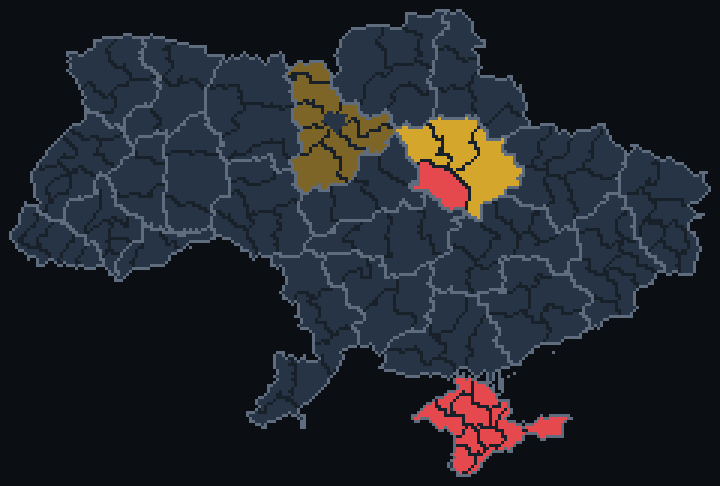

# 🛡 CYD Alert — карта воздушных тревог Украины для ESP32‑2432S028 («Cheap Yellow Display»)

Прошивка для платы ESP32‑2432S028 (2.8" 320×240, ILI9341/ST7789, резистивный тач XPT2046):

* **Карта Украины по районам** (139 районов, границы областей выделены), окрашенная по статусу тревоги в реальном времени, с пульсирующей меткой вашего города.
* **График отключений света** (ГПВ) для вашей очереди 1.1–6.2: индикатор на главном экране («Світло є / Вимкнено до 18:00» + полоска на 8 часов) и экран с почасовой шкалой на сегодня и завтра.
* **Первый запуск — мастер настройки**: Wi‑Fi (скан сетей, экранная клавиатура) → область → город → часть города (район) → *опционально* поиск улицы по базе.
* **Анализ Telegram‑канала** (например [t.me/kremen_sv](https://t.me/kremen_sv) для Кременчуга): посты разбираются по ключевым словам и расстояниям, вычисляется уровень опасности **именно для вашего района**.
* **Четыре уровня по близости угрозы** — без всплывающих окон и кнопок: **сам главный экран** (фон, рамка, карточка статуса) перекрашивается:
  * 🟢 **ЧИСТО** — тревоги нет;
  * 🟡 **ЗАГРОЗА** — дроны в области / общая угроза, официальная тревога без типа (один мягкий сигнал, янтарный LED «дышит»);
  * 🟠 **КУРС НА МІСТО** — цель летит на ваш город («курсом на Кременчук»), дрон в городе/≤15 км, ракеты/КАБ в области,
    официальная «ракетная» тревога в районе (тонкая оранжевая рамка, 3 коротких «бип», напоминание раз в 1,5 мин);
  * 🔴 **НЕБЕЗПЕКА** — цель над вашим районом / курс на район, взрывы в городе, ракеты/КАБ/баллистика рядом
    (весь экран красноватый и пульсирует, толстая красная рамка, сирена 8 с + напоминание раз в минуту, LED мигает).
  Касание карточки статуса глушит звук до следующего повышения уровня. «Відбій · чисто» — тост при отмене.
* Тёмная тема, кириллический шрифт Golos Text, экран деталей, настройки (яркость, звук, токен, сервер, канал, тесты цвета экрана жёлтый/оранжевый/красный, сброс).
* **Сервер‑компаньон** на Python (необязателен): тот же анализ на ПК/Raspberry Pi, Telethon, веб‑дашборд.



---

## 1. Железо

| Узел | GPIO | Примечание |
|---|---|---|
| Дисплей (HSPI) | MISO 12, MOSI 13, SCLK 14, CS 15, DC 2, BL 21 | ILI9341 (`env:cyd`) или ST7789 (`env:cyd2usb`) |
| Тач XPT2046 (VSPI) | CLK 25, MOSI 32, MISO 39, CS 33, IRQ 36 | калибровка в `include/config.h` |
| RGB‑LED (на плате) | R 4, G 16, B 17 | активный LOW |
| Динамик (разъём SPEAK, JST 1.25) | 26 | 8 Ом 0.5–2 Вт, через встроенный усилитель |
| Датчик света | 34 | не используется |

Ничего паять не нужно — достаточно платы, кабеля USB и (по желанию) маленького динамика в разъём `SPEAK`.

**Какая у меня версия платы?** Один micro‑USB → `cyd`. Два порта (USB‑C + micro‑USB, «2USB») → `cyd2usb`.
Если цвета инвертированы/экран «негатив» — смените окружение. Если тач промахивается — подправьте `TOUCH_X_MIN/MAX`, `TOUCH_Y_MIN/MAX` (если ось инвертирована — поменяйте MIN и MAX местами) в `include/config.h`.

## 2. Сборка и прошивка

```bash
pip install platformio          # или установите расширение PlatformIO в VS Code
cd cyd-alert
pio run -e cyd -t upload        # для «2USB»-версии: -e cyd2usb
pio device monitor -b 115200    # лог
```

Перед сборкой автоматически запускается `tools/gen_data.py`, который превращает `data/*.json` в `include/gen_data.h`.
Используется разметка `huge_app.csv` (3 МБ под приложение); прошивка занимает ~1.47 МБ (47%), RAM ~35%.

## 3. Первый запуск

1. **Wi‑Fi** — выберите сеть из списка (цвет иконки = уровень сигнала) или «Ввести вручну», введите пароль (👁 показать).
2. **Область** → **Город** → **Район** (для городов с базой районов: Кременчуг, Полтава, Киев, Харьков, Днепр, Одесса, Львов, Николаев; можно «Весь город»).
3. **Адрес** (для Кременчуга): начните вводить улицу (кнопка «УКР» переключает раскладку) — район подставится автоматически.
4. Главный экран: сверху место/Wi‑Fi/время/⚙, в центре карта районов, справа число районов (или областей, если источник даёт только области) в тревоге, легенда (ракеты / дроны / частично) и блок ⚡ «Світло» — тап открывает график. Снизу карточка статуса. Тап по карточке — подробности (последний пост, тип угрозы, балл, статус вашего района, источники).
5. **⚙ → Світло**: выберите очередь (1.1–6.2), режим (авто / вручную / выключен) и при желании конкретный источник.

Все настройки хранятся в NVS (переживают перепрошивку, пока не стерта flash). «Сброс» в настройках возвращает мастер.

## 4. Источники данных и настройка

### Официальные тревоги
* **alerts.in.ua** (рекомендуется): бесплатный токен на <https://alerts.in.ua/api-request> → **⚙ → Токен alerts.in.ua** (или `DEFAULT_ALERTS_TOKEN` в `include/config.h`). Плата читает `/v1/alerts/active.json` (потоково, с фильтром ArduinoJson) раз в 30 с — там есть **уровень района/громады и тип тревоги** (`air_raid`, `artillery_shelling`, …), поэтому карта красится по районам: тревога по району — ярким цветом, по отдельной громаде — тусклым («частично»). Тревога типа, отличного от `air_raid`, считается красной. При ошибке — запасной `/v1/iot/active_air_raid_alerts.json` (только области).
* Без токена — **ubilling.net.ua/aerialalerts** (только области): при тревоге в области **все её районы** красятся жёлтым. Крым там отсутствует.
* api.ukrainealarm.com требует ключ разработчика — не реализовано.

Цвета карты: 🔴 ракеты/КАБ (весь район), тёмно‑красный — частично; 🟡 дроны/тип не уточнён, тёмно‑жёлтый — частично; серо‑синий — спокойно, чуть светлее — ваша область, ещё светлее — ваш район; тёмный — нет данных.
Тип тревоги в официальных данных обычно не указан, поэтому «ракетный» красный на ESP ставится по Telegram‑анализу; сервер‑компаньон в режиме Telethon/с токеном может дать больше.

### График отключений света
Плата (или сервер, если указан — `/api/outage`) раз в 15 мин скачивает график для вашей очереди. Источники (`data/outages.json`):

| Регион | Источник | Формат |
|---|---|---|
| Полтавская (Кременчуг) | Полтаваобленерго — зеркало [yaroslav2901/OE_OUTAGE_DATA](https://github.com/yaroslav2901/OE_OUTAGE_DATA) (`Poltavaoblenergo.json`) | GPV |
| Киев | **YASNO** API `api.yasno.ua/api/v1/pages/home/schedule-turn-off-electricity` (регион 25, DSO 902) | Yasno |
| Днепр | YASNO (ДнЕМ 3/301, ЦЭК 3/303), DTEK Днепр — [Baskerville42/outage-data-ua](https://github.com/Baskerville42/outage-data-ua) | Yasno/GPV |
| Киевская, Одесская | DTEK — Baskerville42/outage-data-ua | GPV |
| Черкасская, Черниговская, Харьковская, Хмельницкая, Львовская, Ивано‑Франковская, Ровенская, Тернопольская, Закарпатская, Запорожская, Житомирская | соответствующие облэнерго — yaroslav2901/OE_OUTAGE_DATA | GPV |

GPV‑значения часа: `yes` — свет есть, `no` — нет, `first`/`second` — нет первые/вторые 30 мин, `mfirst`/`msecond`/`maybe` — возможно. Yasno: `Definite` — отключение, `NotPlanned` — свет есть, прочее — «возможно»; дни со статусом `WaitingForSchedule` пропускаются.

**Ручной режим** (⚙ → Світло → Режим: вручну): на экране графика тапайте по шкале «Сьогодні», чтобы отметить получасовки без света — график повторяется ежедневно и работает без интернета.

**Ограничения:** у Полтаваобленерго и большинства облэнерго **нет официального API** — используются неофициальные общественные зеркала (парсинг сайтов/Telegram, обновление ~раз в 5–10 мин, могут отставать, менять формат или исчезнуть). API YASNO не документирован. Графики меняются в течение дня (решения НЭК «Укренерго»/НКРЭКП, аварийные ГАВ не публикуются заранее) — всегда сверяйтесь с сайтом/ботом своего облэнерго. В Киеве DTEK‑нумерация групп в зеркале иная (до 60.1), поэтому для Киева основной источник — YASNO. Если источника для области нет — используйте ручной режим.

### Telegram — много каналов
Список каналов — `data/channels.json` (у каждого: `scope` national/oblast/city, области, «домашний» город, вес‑доверие
`weight`, `default`). Все проверены: публичное веб‑превью `t.me/s/<канал>` открывается (28.10.2026).

| канал | что это | охват | вес | по умолч. |
|---|---|---|---|---|
| kremen_sv | Кременчуцький Миколай (ППО, 105K) | Кременчук | 0.9 | ✔ |
| ppo_poltava | ППО Полтавщина: Нічні мисливці (34K) | Полтавська | 0.75 | ✔ |
| poltavskaODA | Полтавська ОВА (офіц.) | Полтавська | 0.95 | ✔ |
| kremenchuk_info | Кременчук INFO (новини) | Кременчук | 0.5 | |
| poltava_monitor | Полтава І Моніторинг | Полтавська | 0.55 | |
| kpszsu | Повітряні Сили ЗСУ (офіц., 914K) | вся Україна | 1.0 | ✔ |
| war_monitor | monitor (960K) | вся Україна | 0.8 | ✔ |
| kudy_letyt | Ринда моніторить (155K) | вся Україна | 0.75 | ✔ |
| raketa_trevoga / eRadarrua / mon1tor_ua | радари (477K / 410K / 265K) | вся Україна | 0.6–0.7 | |
| vanek_nikolaev | Николаевский Ванёк (2.6M) | Миколаївська, Одеська, Херсонська | 0.75 | ✔ |
| monitor1654, synegubov | Харків монітор / Харківська ОВА | Харківська | 0.75 / 0.95 | ✔ |
| dnipropetrovskaODA, kirovogradskaODA, cherkaskaODA, kyivoda, KyivCityOfficial, odeskaODA, zoda_gov_ua, Sumy_news_ODA, chernigivskaODA, zhytomyrskaODA | офіційні ОВА / КМДА | своя область | 0.9–0.95 | ✔ |

Как анализируются несколько каналов (`analyze_multi` в `server/analyzer.py`, то же в `src/netsvc.cpp`):
* **свой** канал (городской канал вашего города или областной вашей области) — как раньше;
* **чужой** (общенациональный или другой области) — пост учитывается, только если в нём есть ваш город/район/село,
  ваша область («на Полтавщині») или место ближе 60 км; иначе — «не про вашу область» (только информация).
  «Відбій» из чужого канала ваш уровень не сбрасывает; «балістика!» без места из общенационального канала — не «вся область»;
* одинаковые события (тип угрозы + место, ±10 мин) из разных каналов сливаются в одно; доверие = 1 − Π(1 − weight);
  ≥ 2 канала → балл +1 и пометка «N канали»; красный только из маловесных каналов (доверие < 0.5) понижается до оранжевого;
* трекер целей получает посты всех каналов (повторы одного события сливаются его же ассоциацией треков).

**На ESP** (⚙ → Telegram: N каналів): галочки по каналам (сверху — вашего региона, потом общенациональные, потом других
областей), «Свій канал» (любой публичный), «Типові для області». Плата читает их **по очереди**: свои — раз в ~25 с,
общенациональные — раз в 60 с, не чаще одного запроса в 4 с (страница читается потоком, в RAM хранится только
короткая сводка по каждому каналу, ~7 КБ на все). Плюс сводка из облака (все 24 канала), если она свежая.

### Сервер‑компаньон (необязательно, но надёжнее)
Если указать в **⚙ → Сервер** адрес вида `http://192.168.1.10:8080`, плата будет брать уровень с сервера (раз в 10 с), а при недоступности сервера — снова читать t.me сама.

```bash
cd server
ALERTS_TOKEN=ваш_токен ./run.sh          # Python 3.9+, без зависимостей
# дашборд: http://<ip>:8080/
# API:     /api/state?oblast=16&city=kremenchuk&district=molod   /api/posts?channel=kremen_sv
#          /api/outage?oblast=16&group=3.1[&prov=poe]   (48 получасовок на сегодня/завтра)
```

Режим Telethon (читает канал от вашего аккаунта, без задержек веб‑превью):
```bash
pip install telethon
TG_MODE=telethon TG_API_ID=12345 TG_API_HASH=abcdef... ./run.sh   # ключи с my.telegram.org; при первом запуске спросит телефон и код
```
Переменные: `PORT` (8080), `ALERTS_TOKEN`, `UKRAINEALARM_KEY`, `JAAM` (1/0), `TARGETS_URL`, `RADIUS_KM` (15), `TG_POLL` (20 с), `ALERTS_POLL` (15 с), `TG_MODE` (`web`|`telethon`).

### Без своего сервера: GitHub Actions (по умолчанию) — обновление ~раз в минуту
Репозиторий `Bodya86/cyd-alert` (публичный — минуты Actions бесплатны).

* **`.github/workflows/live.yml`** — один длинный job (~5 ч 50 мин): JAAM WebSocket подключён **постоянно**,
  каждые ~60 с читает все каналы из `data/channels.json` (8 параллельно), считает трекер и пишет `api/*.json`
  (файл перезаписывается только если изменился, иначе раз в 5 мин как «пульс» — поле `generated`).
  Публикация — **один коммит без истории, force‑push в ветку `data`** (деплой Pages каждую минуту слишком тяжёлый).
  Cron `*/15` только подхватывает работу, если job закончился/упал; `concurrency: live` не даёт запустить второй
  параллельно (один работает + один ждёт). Стан трекера при старте берётся из `data:tracker_state.json`.
* **`.github/workflows/update.yml`** — раз в час: та же сборка на GitHub Pages (резерв + дашборд `index.html`;
  дашборд сам читает свежие файлы из ветки `data` через raw.githubusercontent.com).

Что реально с кэшем (замерено 28.10.2026):

| источник | заголовки | задержка |
|---|---|---|
| `api.github.com/repos/Bodya86/cyd-alert/contents/<путь>?ref=data` + `Accept: application/vnd.github.raw` | `cache-control: public, max-age=60, s-maxage=60`, `ETag` = sha файла; `If-None-Match` → **304 не тратит лимит** | **≈ 1–2 мин** (цикл 60 с + кэш ≤ 60 с) |
| `raw.githubusercontent.com/Bodya86/cyd-alert/data/<путь>` | `cache-control: max-age=300` (Fastly), `?t=…` кэш **не** сбрасывает; без авторизации с мая 2025 бывают 429 | до 5–6 мин |
| `bodya86.github.io/cyd-alert/…` (Pages) | `max-age=600`, `?t=` не помогает | до ~70 мин (раз в час + кэш) |

ESP поэтому читает: **GitHub API (ETag)** → raw → Pages. Без токена лимит API — 60 запросов/час с IP, поэтому
опрос раз в 75 с (≤ 48/ч, 304 не считаются); с токеном (⚙ → GitHub token, fine‑grained, только чтение публичных
репозиториев) — раз в 20 с (лимит 5000/ч). Если лимит почти исчерпан (`x-ratelimit-remaining` ≤ 2) или 403/429 —
до сброса читается raw. Тревоги (alerts.in.ua/ubilling) и Telegram плата всё равно читает и сама — облако даёт прогноз
целей, сводку по всем каналам и резерв.

Задержки GitHub: cron может опаздывать на 5–20 мин (поэтому job длинный, а cron лишь перезапускает), следующий
job уже стоит в очереди (`concurrency`) и стартует сразу после предыдущего — пауза раз в ~6 ч обычно 1–2 мин
(старт раннера + первая итерация); если очереди не было — до ~15 мин до ближайшего cron.

**Включение:**
1. Pages менять не нужно: **Settings → Pages → Source: GitHub Actions** (как уже стоит).
2. **Actions → live → Run workflow** (первый раз вручную), и один раз **Actions → update-static → Run workflow** —
   до первого запуска сайт отдаёт 404. Дальше всё по cron.
3. Если шаг push в live падает с 403: **Settings → Actions → General → Workflow permissions → Read and write**.
4. Необязательно: Settings → Secrets → Actions: `UKRAINEALARM_KEY`, `ALERTS_TOKEN`.
5. На ESP адрес по умолчанию `https://bodya86.github.io/cyd-alert` — из него плата сама выводит owner/repo для API и raw.

⚠ Честно о рисках: правила GitHub Actions запрещают использовать раннеры как «serverless‑хостинг» для задач, не
связанных с проектом; круглосуточный job‑опросчик может быть ограничен/отключён GitHub. Scheduled‑workflow
автоматически отключаются через 60 дней без активности в репозитории (нужен любой коммит). Надёжнее — свой
сервер‑компаньон (Windows/малинка) или VPS.

#### Запуск сервера на Windows
1. Установите Python 3.9+ с python.org (галочка «Add python.exe to PATH»). Дополнительные пакеты не нужны.
2. Распакуйте архив, откройте папку `cyd-alert\server` и дважды щёлкните `run_windows.bat`
   (или в cmd: `cd cyd-alert\server` → `run_windows.bat`; вручную: `py -3 server.py`).
3. Порт **8080** (поменять: `set PORT=9000` перед запуском). Дашборд: `http://localhost:8080/`.
4. При первом запуске Windows спросит про брандмауэр — разрешите «Частные сети». Или вручную (cmd от администратора):
   `netsh advfirewall firewall add rule name="CYD Alert 8080" dir=in action=allow protocol=TCP localport=8080`
5. IP компьютера: `ipconfig` → «IPv4-адрес» (например 192.168.1.50). На ESP в настройках «Сервер»: `http://192.168.1.50:8080`.
6. Ключи (по желанию) — раскомментируйте строки `set ALERTS_TOKEN=` / `set UKRAINEALARM_KEY=` в `run_windows.bat`.

### Цели и прогноз (сервер‑компаньон)
С сервером плата рисует на карте **цели**: значок по типу (▲ дрон по курсу — жёлтый/оранжевый/синий‑разведчик, ◆ ракета — красный, КАБ — оранжевый), линию прогноза со стрелкой (+5/+15/+30 мин) и полупрозрачный **конус неопределённости** (σ поперёк курса). В карточке: `P(близько) 62% · ETA 12 хв`. Без сервера — всё как раньше.

```
GET /api/targets?city=kremenchuk[&district=molod][&lat=..&lon=..][&R=15]
  → targets[]: type, lat/lon, heading (+heading_conf 0..1), speed, sd_km, p{5,15,30}, eta_min, path[[lat,lon,σкм]…], src
  → summary: p_any / p_drone / p_missile {5,15,30}, eta_min, level
/api/state   + p_near, p_drone, p_missile, p_near15, eta, tlevel, ballistic, tgt[] (до 6 целей, компактно для ESP)
```

**Откуда данные о целях (проверено 28.10.2026):**
* `map.ukrainealarm.com` — цели (ракета, шахед, реактивный шахед, «бандероль», КАБ) приходят из закрытого API; сам сайт пишет, что данные «попередньо оброблені», **без точных координат и трекинга в реальном времени**, с задержкой; баллистика и цели >2000 км/ч не показываются. Сайт, `api.ukrainealarm.com` и `map.war-monitor.org` закрыты Cloudflare‑челленджем для автоматических клиентов — **мы это не обходим**.
* `api.ukrainealarm.com` v3 — только с **ключом разработчика** (заявка: форма на https://api.ukrainealarm.com/ — имя, компания, описание проекта; заголовок `Authorization: <KEY>`). Публично документированы тревоги по регионам (`/api/v3/alerts`, `/regions`, история, webhook), **эндпоинта целей в документации нет**. Ключ указывается в `UKRAINEALARM_KEY` — сервер берёт с него тревоги по районам/громадам (адаптер не проверен вживую: ключа нет).
* **JAAM** (`jaam.net.ua`, открыто, без ключа, **обязательна атрибуция «Дані: JAAM (jaam.net.ua)»**) — WebSocket `wss://ws.jaam.net.ua/data_fusion_v1`: тревоги по ~1600 регионам (область/район/громада) с флагами дроны/ракеты/уровень жёлтый/красный и **разовые события** «дрон/ракета/КАБ/балистика/взрыв» по региону. Используется по умолчанию (`JAAM=0` — выключить); соблюдаем их правила: стабильный `chip_id`, переподключение 4…128 с с джиттером.
* Telegram‑канал (например `kremen_sv`): «курсом на X», «над X», «з боку X», «збито», «на виліт» + газетир (~730 н.п. и районов, `data/gazetteer.json`).
* `TARGETS_URL` — свой источник точек целей, JSON `[{type, lat, lon, heading?, ts?, sigma?}]` (например, если получите легальный доступ к фиду).

**Модель** (`server/tracker.py`): на каждую цель — **частичный фильтр** (300 частиц: x, y, курс, скорость, пройденный путь). Движение: скорость по типу (шахед 170±15 км/ч, реактивный 450, разведчик 120, крылатая 800±80, КАБ 450 с дальностью ~70 км, баллистика — событие без траектории), курс — случайное блуждание. Наблюдения: позиция («над X») — гаусс σ≈5–9 км (район — по его радиусу, область — 50 км); «курсом на X» — фон Мизес по направлению на X; «з боку X» — по направлению от X; тревога/событие в районе — слабое наблюдение «рядом с районом»; отбой — мягко понижает вес частиц внутри; «збито»/«на виліт» снимают цель. Ассоциация — по правдоподобию позиции и совместимости типа, иначе новая цель. Прогноз: каждую частицу ведём 30 мин шагом 1 мин, P(T) = вес частиц, чьи отрезки прошли ≤ R км от вас до момента T; ETA — взвешенная медиана времени входа. Группа из n целей: 1−(1−p)^√n (полёт коррелирован). Уровень трекера: 🟡 если P(дрон, 30 мин) ≥ 15 %, 🔴 если P(ракета, 30 мин) ≥ 10 % или балистика по вашему району/области. Итог = max(прежняя логика, уровень трекера). Официальный `level_red` JAAM (по гос. определению — ракеты, комбинированная или массированная атака дронов) и флаг «ракеты» → 🔴.

Тесты на синтетических треках: `cd server && python3 -m unittest test_tracker test_alerts test_analyzer -v`.

## 5. Как считается опасность

Каждый пост нормализуется (нижний регистр, ё→е, апострофы) и оценивается баллами (`src/analyzer.cpp` = `server/analyzer.py`):

| Признак | Баллы |
|---|---|
| Тип цели: ракета/КАБ 4 (🔴) · шахед/БпЛА/«мопед» 3 (🟡) · авиация 2 (🔴) · прочее 1 (🟡) | +1…4 |
| Упомянут ваш город («Кременчуг», «на город», «по нам»…) | +2 (ракета по городу ещё +1) |
| Курс/подлёт («курсом на», «летит на», «заходит»…) + город | +2 (+1 если только соседний н.п.) |
| Ваш район / соседний (в пределах 60°) / другой район | +4 / +2 / +1 |
| Населённый пункт рядом: ≤15 км +2, ≤45 км +1, и +1 если с вашей стороны города | +1…3 |
| Взрывы, работа ПВО, «в укрытие» | +3 |
| «Отбой», «пролетел», «на вылет», «чисто» (без взрывов) | сброс в зелёный |
| Реклама (≥2 слов‑маркеров или 1 в длинном посте) | игнор |

**Балл ≥3** — пост значимый; уровень = **класс угрозы × близость**:

| Класс \ близость | область / далёкий н.п. | ваш город, курс на город, н.п. ≤15 км (балл ≥7) | ваш район (или соседний + курс/взрывы), взрывы в городе |
|---|---|---|---|
| Дроны / прочее | 🟡 | 🟠 | 🔴 |
| Ракеты / КАБ / авиация | 🟠 | 🔴 (и любой упомянутый н.п. рядом) | 🔴 |

Баллистика без места («хз откуда») или «на Полтавщину» → 🔴 на всю область 10 мин. Дрон движется: каждые 10 мин без новых
постов близость падает на ступень (🔴 → 🟠 → 🟡). Посты старше 40 мин не учитываются, ракетные — старше 15 мин.
Официальная тревога в районе: ракетная → 🟠, дроны/без типа → 🟡. Трекер сервера: P(дрон рядом за 30 мин) ≥15% → 🟠;
P(за 15 мин) ≥50% или P(ракета за 30 мин) ≥10% → 🔴.
Итог: если есть официальная тревога в вашем районе (или в области, если район не определён) — max(официальный уровень, Telegram); иначе Telegram‑уровень учитывается только при балле ≥5, иначе 🟢.

Правила лежат в `data/rules.json` (ключевые слова, веса, населённые пункты вокруг Кременчуга с азимутом и расстоянием) — их легко дополнять под свой канал/жаргон.
Проверка правил на ПК:
```bash
cd server && python3 -m unittest test_analyzer -v
test/host/run_tests.sh /path/to/saved_t.me_s_page.html   # C++‑версия + парсер HTML (нужен g++; или CXX="python3 -m ziglang c++")
```


**Сленг и опечатки.** Текст нормализуется (нижний регистр, і/ї/ы→и, є/э/ё→е, без ь/ъ/апострофов и эмодзи), слова угроз ищутся
нечётко (Левенштейн ≤1–2 по основе): «бублистика», «болистика», «балик», «баліста», «рокета», «шахиды», «мопеды», «кабы»…
«Хз откуда» / «невідомо звідки» + баллистика → красный на всю область на 10 мин. Пост вида «Харьков ракета» (город >150 км,
курса на нас нет) — только заметка «далеко: Харків ~227 км», уровень не повышается. Кейсы: `test/analyzer_cases.json`
(общие для Python и C++). Русские/укр. названия городов — `data/rules.json → places`.

## 5a. Зум карты, цели и историческая модель маршрутов

**Зум.** Тап по карте: вся Украина → ваша область (границы районов, города) → район города ~60–80 км (сёла, Днепр, метка вашего района) → снова Украина. Переход — быстрая анимация рамки (180 мс). Внизу слева подпись уровня. Настройка «Автозум мапи до загрози» (по умолчанию вкл.): цель в области / курс к ней / жёлтый уровень → область; оранжевый+ или цель ближе 45 км → район; возврат к Украине через 2 мин без угрозы. Ручной тап отключает автозум на 3 мин. Полигоны для каждого вида пересчитаны заранее (`tools/gen_map_views.py` → `include/map_views.h`, 62 вида, ~400 КБ флеша).

**Цели.** Иконки масштабируются с зумом, подпись «Шахед ×2 · 38 км» (расстояние — на приближенных видах), курс-стрелка; прогноз курса — **штриховая линия** с поперечными метками +5/+15/+30 мин (на зуме подписаны) и бледным конусом неопределённости (σ из частиц). Несколько групп (например, шахеды над Сумщиной и над Запорожьем) — отдельные треки; сервер сортирует по P, затем по расстоянию, и убирает дубли <8 км, чтобы на карте были разные группы.

**Историческая модель** (`data/history_model.json`, ~65 КБ):
* `tools/history_collect.py` — архив публичных постов `t.me/s/<канал>?before=<id>` (без аккаунта, с паузами) → `data/history/raw/` (не в git).
* `tools/history_model.py` — геокодинг (gazetteer + GeoNames, `data/geonames_ua.json`, `tools/build_geonames.py`), события «положение / курс на / попадание», волны атак, переходы; (а) поле направлений на сетке 0.25° (8 румбов, сглаживание 3×3), (б) априорная P(цель атаки = город) = (1+упоминаний)^γ·exp(−d/λ)·base + исторические пары «откуда → куда», с учётом курса (фон Мизес). γ, λ, base подбираются на валидации. Тот же расчёт — `server/history.py`.
* Сервер: для дронов без известного курса 60 % частиц получают стартовый курс из поля; в ответе `lt`/`lp` (вероятная цель, для вашего города если он среди узлов) и `hm` (окно 28×18 клеток base36 — слой «Типові маршрути» на зуме области, включается в настройках). Без файла модели всё работает как раньше; `NO_HISTORY=1` отключает.
* `.github/workflows/history.yml` — еженедельно докачивает архив (кэш), пересобирает модель и коммитит JSON.

Данные (сборка 29.10.2026): 39 828 постов из 11 каналов (основная масса — последние 2–4 месяца; у крупных каналов ~4 400 последних постов), 25 861 положение, 27 864 «курс на», 563 упоминания попаданий; 204 волны (163 обучение / 41 тест — последние по времени).
Бэктест на отложенных волнах:

| Задача | База | Модель |
|---|---|---|
| Направление по явному «курсом на» (n=4200) | равномерно top1 0.117, logloss −2.079 | поле top1 **0.223**, −1.986 |
| Направление по цепочкам положений (n=2607) | равномерно 0.105, −2.079 | поле 0.164, −2.163 (хуже по logloss: связка «та же цель» в общих каналах ненадёжна, поэтому её вес 0.3) |
| Цель атаки (n=1897) | только расстояние top1 0.247 / top3 0.484 | история top1 **0.325** / top3 **0.572**, logloss −2.597 vs −2.855 |

Честно: выигрыш даёт в основном «какие города обычно цели» + расстояние; пары «из этой клетки → туда» почти ничего не добавляют сверх этого (данных мало). Это ориентир, не прогноз удара.

## 6. Данные и как их менять

* `data/locations.json` — области (порядок как в API alerts.in.ua), города (координаты, канал, ключевые слова), районы (`sector` — азимут от центра в градусах, `-1` = центр).
* `data/rules.json` — правила анализа.
* `data/streets_kremenchuk.json` — улицы → район (демо‑база ~40 улиц).
* `data/outages.json` — очереди и источники графиков отключений (можно добавить свой URL в формате GPV/Yasno).
* Карта: `tools/simplify_adm2.py` (OCHA COD‑AB ADM2 → упрощённый `tools/ukraine_adm2.geojson` с UID районов alerts.in.ua), затем `python3 tools/gen_map.py` (нужен Pillow) → `include/map_meta.h`, `include/map_data.h` (RLE ~10 КБ), `data/regions.json`, `data/city_regions.json`, `docs/map_preview.png`.
* Шрифты: `tools/gen_fonts.sh` (нужны `npm i -g lv_font_conv`, `pip install fonttools`).

## 7. Ограничения (важно!)

* ⚠️ **Это вспомогательное устройство, а не замена официальным сигналам.** Всегда реагируйте на сирену и официальные приложения («Повітряна тривога»).
* Анализ Telegram — эвристика по ключевым словам: возможны ложные срабатывания и пропуски; админы каналов пишут сленгом, эмодзи (🚬 и т.п.) не трактуются. Правила стоит подстраивать.
* Границы районов (азимуты) и база улиц — **приблизительные демо‑данные**, проверьте под свой город.
* Веб‑превью t.me может отставать, менять разметку или ограничивать частые запросы; Telethon‑режим сервера надёжнее.
* **Прогноз целей — вероятностная оценка по неточным текстовым данным**, а не радар: позиции из Telegram/районов имеют ошибку 5–50 км, P и ETA — ориентир. При σ наблюдений ~9 км курс известен лишь ±20°, поэтому P(близько) редко бывает близка к 100 % заранее. Балистика летит минуты — сервер показывает её только как событие с априорной вероятностью.
* Точных координат целей из открытых источников нет (map.ukrainealarm.com их тоже не публикует).
* TLS без проверки сертификатов (`setInsecure`) ради экономии памяти.
* Нет PSRAM: читаются последние ~10 постов, текст поста обрезается до ~350 байт.
* Протестировано компиляцией (`pio run`, оба окружения) и юнит‑тестами анализатора/парсера на реальной выгрузке канала; на живой плате калибровку тача может понадобиться подстроить.

## 8. Лицензии

Границы районов — OCHA / [HDX COD‑AB Ukraine](https://data.humdata.org/dataset/cod-ab-ukr) (CC BY 3.0 IGO), упрощены. UID районов — из `alerts_in_ua` (PyPI) (MIT). Соответствие регионов ukrainealarm/JAAM (`tools/src/uaapi.json`, `tools/src/jaam_regions.json`) — из репозитория J‑A‑A‑M/ukraine_alarm_map (GPL‑3.0; используются только идентификаторы и координаты как факты). Данные тревог — **JAAM (jaam.net.ua)**, атрибуция обязательна (показывается в дашборде и API). Данные графиков — от облэнерго/YASNO через указанные зеркала, только для личного использования. Реки/водоёмы — Natural Earth (public domain). Населённые пункты — GeoNames (CC BY 4.0). Исторические посты — публичные веб‑превью Telegram‑каналов, в репозиторий попадает только агрегированная модель. Шрифт Golos Text — SIL OFL 1.1. LVGL, TFT_eSPI, XPT2046_Touchscreen, ArduinoJson — по их лицензиям.
